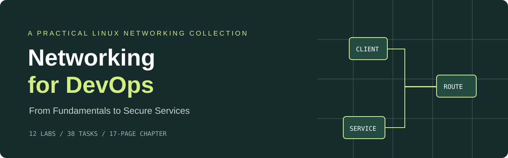

<p align="center"></p>

<p align="center"><strong>A chapter you can read. A network you can investigate.</strong></p>

<p align="center">
  <a href="https://MohammadFatahi.github.io/networking-for-devops/">Learning site</a> ·
  <a href="chapter/main.pdf">Read the chapter</a> ·
  <a href="exercises/EXERCISES.md">Open the workbook</a> ·
  <a href="solutions/SOLUTIONS.md">Explore the answers</a>
</p>

This collection connects networking concepts to Linux commands, service configuration, and diagnostic evidence. **Networking for DevOps: From Fundamentals to Secure Services**, by Mohammad Fatahi, is accompanied by **12 labs and 38 tasks** translated and consolidated from two networking exercise sets.

## Start Here

1. Read the [17-page chapter](chapter/main.pdf) for the concepts behind the commands.
2. Work through the [English workbook](exercises/EXERCISES.md) on an appropriate Linux lab host.
3. Compare your reasoning with the [translated answers](solutions/SOLUTIONS.md) and each lab's supplied reports.

The [public learning site](https://MohammadFatahi.github.io/networking-for-devops/) includes searchable lab cards, a chapter download, complete exercise text, expandable answer files, and a local progress checklist. It requires no account or backend.

## Learning Path

| Lab | Topic | Source |
| --- | --- | --- |
| [01](solutions/lab-01/) | Interfaces, static addressing, connectivity, ports | Assignment 01 / Scenario 1 |
| [02](solutions/lab-02/) | Packet capture, Wireshark, client port tests, OSI | Assignment 01 / Scenario 2 |
| [03](solutions/lab-03/) | Firewall policy and suspicious traffic | Assignment 01 / Scenario 3 |
| [04](solutions/lab-04/) | Local names, routing, star topology | Assignment 01 / Scenario 4 |
| [05](solutions/lab-05/) | TCP/UDP and performance measurements (bonus) | Assignment 01 / Scenario 5 |
| [06](solutions/lab-06/) | Certificates, TLS, Python HTTPS | Assignment 02 / Scenario 1 |
| [07](solutions/lab-07/) | vsftpd, transfers, FTP/SFTP/SCP | Assignment 02 / Scenario 2 |
| [08](solutions/lab-08/) | HTTP servers, methods, status codes, headers | Assignment 02 / Scenario 3 |
| [09](solutions/lab-09/) | DNS records, query analysis, CDN, BIND | Assignment 02 / Scenario 4 |
| [10](solutions/lab-10/) | SSH keys, tunnels, hardening | Assignment 02 / Scenario 5 |
| [11](solutions/lab-11/) | Traffic rates, logs, terminal dashboard | Assignment 02 / Scenario 6 |
| [12](solutions/lab-12/) | Unreachable websites, slow paths, SSH timeouts | Assignment 02 / Scenario 7 |

## What Is Included

```text
chapter/                  LaTeX source, bibliography, four illustrations, PDF
exercises/EXERCISES.md     One complete English exercise sequence
solutions/lab-01..lab-12/  English answers, scripts, configs, recorded reports
solutions/SOLUTIONS.md    Answer index and interpretation notes
docs/                     Static GitHub Pages learning site and downloads
collection-manifest.json  Source-to-lab mapping and file provenance
results/commands_history.txt  Sanitized historical command sequence
```

Interface names, addresses, and installed tools depend on the lab environment. Read configuration-changing scripts before running them. Setup scripts can install packages, create a lab account, change FTP configuration, or alter firewall rules. The exercises identify alternatives when a tool or second host is unavailable.

## Evidence and Editorial Notes

Reports are translated **historical supplied outputs**, not a claim that every command was rerun for publication. Educational sample logs remain labeled as samples. Identifying host addresses, tailnet identifiers, MAC addresses, fingerprints, and sensitive HTTP headers have been redacted in public text. Raw pcaps, screenshots containing host data, and private keys are preserved in the local original archive and are excluded from Git and public downloads.

Some source files were empty: the first set's `ports_status.txt` and `portchech.sh`. This collection records that gap instead of inventing output. It also notes source inconsistencies in scoring, capture duration, anonymous FTP policy, and the range of ten user addresses. Modern Python TLS and transport qualifications are identified as editorial clarifications.

The English translation, consolidation, and editorial preparation were assisted by AI. This is a public learning resource; follow your course's own rules about permitted assistance if using the underlying exercises for assessment. Original exercise texts and supplied illustrations retain their original authorship; no ownership of third-party materials is claimed.

## Build or Preview

The site is plain HTML, CSS, and JavaScript. From `docs/`, run:

```bash
python3 -m http.server 8000 --bind 127.0.0.1
```

Open `http://127.0.0.1:8000`. Rebuild the chapter by following [its LaTeX instructions](chapter/README.md). GitHub Pages serves `main:/docs`.

For improvements, report the concrete command, environment, observed output, and expected behavior in an issue. Keep credentials and private captures out of reports.
